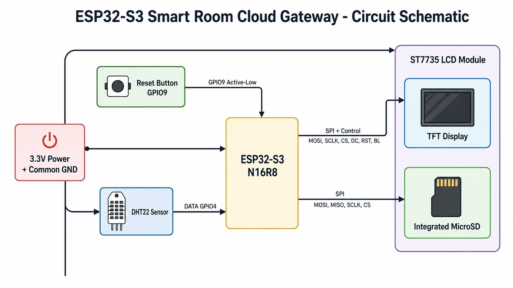
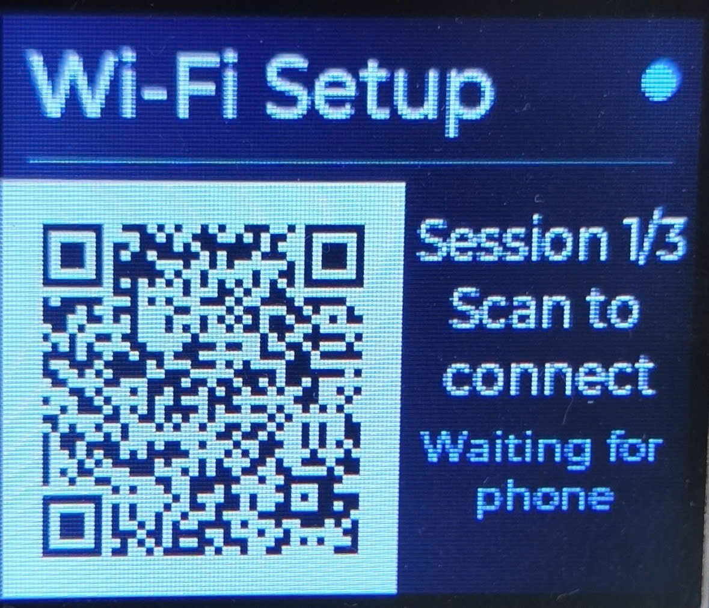
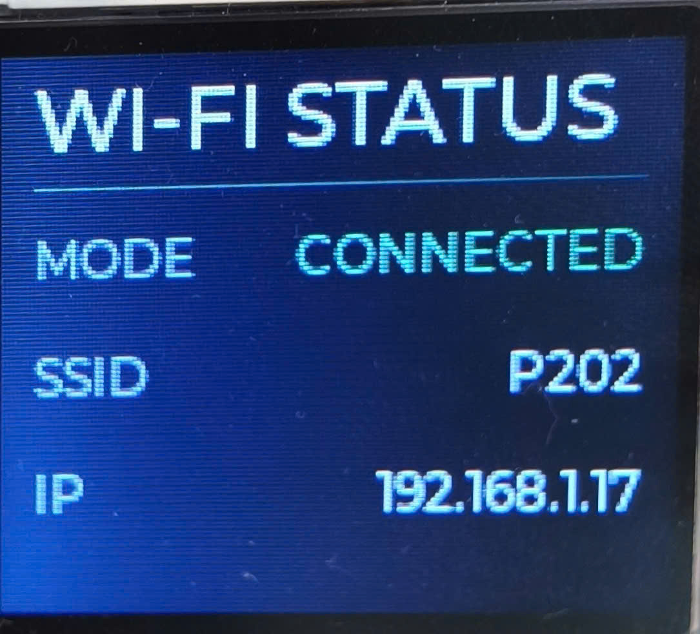
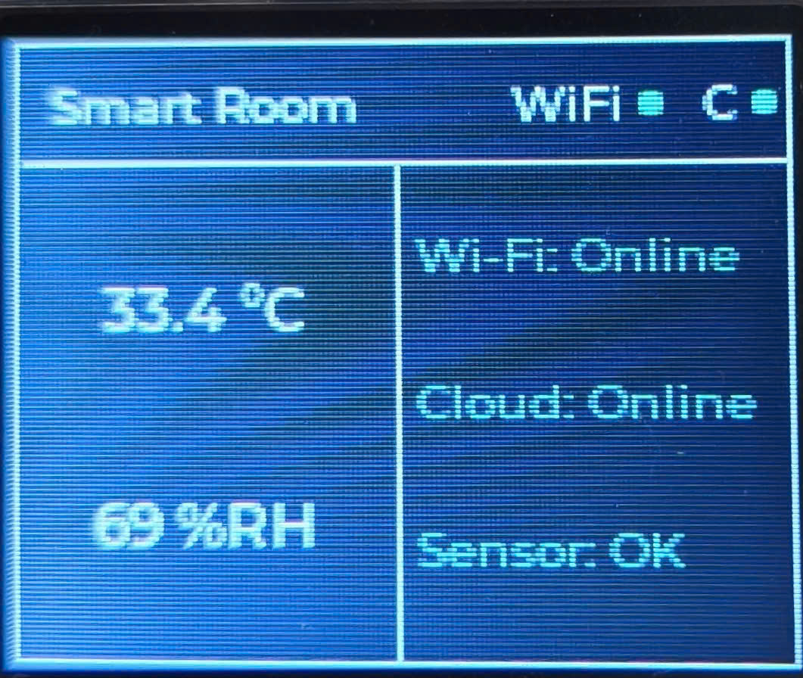
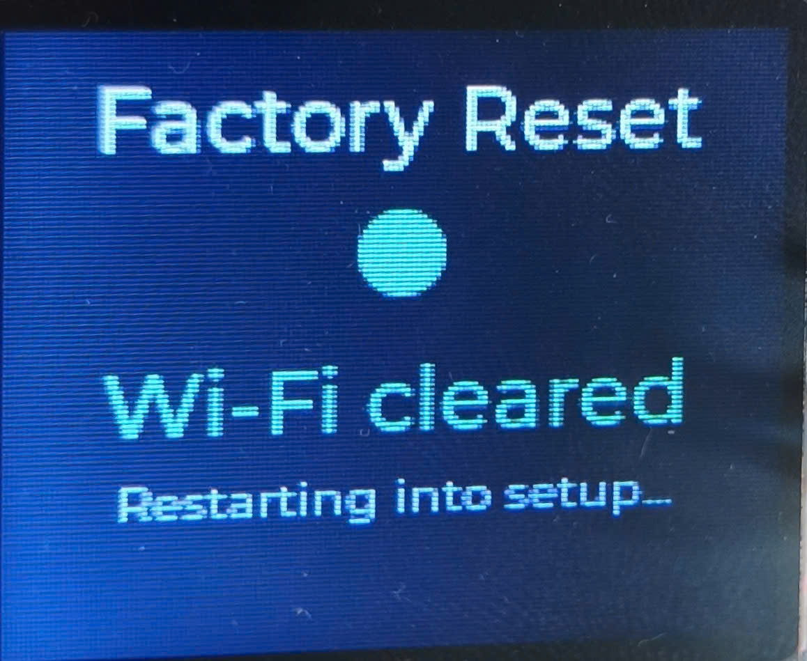
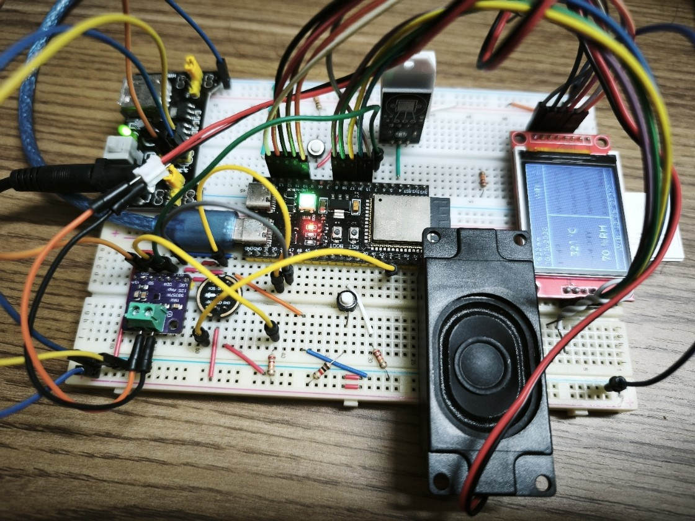
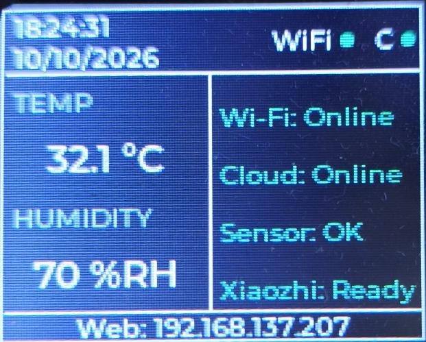
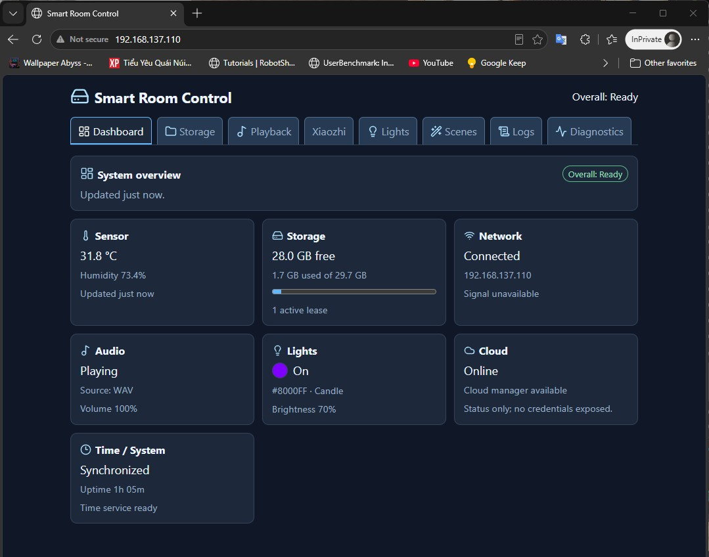

# ESP32-S3 Smart Room Cloud Gateway

An ESP-IDF gateway for the ESP32-S3 N16R8 that combines a local dashboard,
sensor and Firebase telemetry, SD-backed audio, Xiaozhi voice interaction,
bounded MCP tools, and a Local Web control surface.

**Version 2.0.0 release source** extends the accepted Version 1 gateway. It is
portfolio/development firmware: documentation is complete, while selected V2
hardware evidence remains `PENDING OWNER EVIDENCE`.

## Key Features

### Version 1 gateway baseline

- ST7735/LVGL dashboard and DHT22 temperature/humidity monitoring
- BLE Security 1 Wi-Fi provisioning, NVS configuration, and Station reconnect
- Firebase Authentication and Realtime Database latest-value telemetry
- microSD/FAT VFS support, persistent logs, diagnostics, and factory reset

### Version 2 audio, voice, and control

- INMP441 microphone and MAX98357A speaker through the single-owner
  `audio_manager` I2S/DMA pipeline
- Recorded playback and bounded PCM16 mono 16 kHz WAV playback from SD
- GPIO38 and Local Web remote push-to-talk through `voice_assistant`
- Xiaozhi WebSocket sessions, first-boot activation, and bounded recovery
- MCP sensor, cloud status, system status, cloud push scheduling, light, and
  audio playback controls
- Local Web storage, audio, light, dashboard, scene, log, diagnostic, and
  remote-PTT controls

Wake word and advanced always-on voice UX are suspended and are not V2.0.0
features.

## Hardware Overview

| Device | Role |
|---|---|
| ESP32-S3 N16R8 | 16 MB flash / 8 MB PSRAM controller |
| ST7735 | 128×160 SPI display |
| DHT22 | Temperature and humidity sensor |
| microSD | FAT VFS, WAV, logs, and assets |
| INMP441 / MAX98357A | I2S microphone / speaker path |
| GPIO9 / GPIO38 / GPIO48 | Reset / PTT / NeoPixel |

Use [`board_config.h`](components/system/common/include/board_config.h) as the
single source of truth for wiring and pin assignments.

## System Architecture

`main` is intentionally thin. `smart_room_app` composes product services,
startup policy, and copied callback routes; individual components retain their
resources and lifecycle ownership.

```text
main -> smart_room_app
          |- app_network_coordinator -> wifi_manager / provisioning_manager
          |- audio_manager <-> voice_assistant -> xiaozhi_foundation
          |- smart_room_mcp_adapter -> public owner APIs
          |- cloud_manager / firebase_auth
          |- sd_card_manager / log_manager / performance_monitor
          `- app_gui -> ui_manager_lvgl
```

See [Architecture](docs/ARCHITECTURE.md) and
[Component organization](components/README.md) for the runtime, task, and
memory boundaries.

## Audio And Voice Assistant

`audio_manager` is the sole I2S RX/TX, DMA, PCM, recording, and playback owner.
`voice_assistant` owns conversation policy and arbitrates PTT; it never steals
audio resources. WAV playback is bounded and supports PCM16 mono 16 kHz files
smaller than 2 GiB. A request accepted by an MCP or Web API is scheduling state,
not a guarantee that audible playback has already occurred.

## Xiaozhi Activation

The default Menuconfig path is:

```text
Smart Room Cloud Gateway
  -> Xiaozhi / Voice Assistant
      -> Enable Xiaozhi first-boot activation flow
```

If the backend requests activation, the firmware copies and displays the code
and message, keeps unrelated gateway services available, blocks PTT/session
startup, and rechecks backend state with bounded retries. It does not persist
an activation result in NVS. See [activation setup](docs/SETUP.md#xiaozhi-first-boot-activation).

## MCP Capabilities

The production Xiaozhi session registers:

```text
smart_room.get_current_temperature_humidity
smart_room.get_cloud_sync_status
smart_room.get_system_status
cloud.push_latest
light.set_state / light.get_state / light.get_capabilities
audio.control_playback / audio.get_playback_state
audio.list_tracks / audio.play_track / audio.play_recorded
```

Query tools return bounded copied state. Controlled operations stay with their
owners: for example, `cloud.push_latest` reports admission only and does not
claim an upload completed.

## Local Web Dashboard

When `LOCAL_WEB_SERVER_ENABLE` is enabled and the gateway is online, the Local
Web UI serves bounded controls for SD storage, playback/volume/seek, lights,
dashboard, scenes, logs, diagnostics, and remote PTT. It is a remote-control
interface: browser code never owns microphone capture, PCM/Opus transport, or
the Xiaozhi session.

## Configuration And Quick Start

1. Install ESP-IDF 6.0.1 and clone this repository.
2. Configure local Firebase values only in generated `sdkconfig` through
   `idf.py menuconfig`; never commit those values.
3. Build with `idf.py build`, then flash and monitor with
   `idf.py -p <PORT> flash monitor`.
4. Provision Wi-Fi with the BLE flow when no valid configuration is present.
5. Complete Xiaozhi activation if the device presents an activation code.

Detailed wiring, SD preparation, Menuconfig, Local Web, activation, and
troubleshooting are in [Setup](docs/SETUP.md).

## Demo And Evidence

The following real images and video are **Version 1 hardware evidence**:

| Prototype | Provisioning |
|---|---|
|  |  |

| Wi-Fi | Dashboard | Reset |
|---|---|---|
|  |  |  |

[Watch the Version 1 hardware demo](https://youtube.com/shorts/9C5_hecEgXA?feature=share).

### Version 2 evidence

| Prototype | LCD dashboard | Local Web |
|---|---|---|
|  |  |  |

[Watch the V2 PTT demonstration](https://youtube.com/shorts/rdfI0ZxzbNA?feature=share)
and [the full V2 demonstration](https://youtu.be/r4Q5xO2WkmA). More screenshots,
the schematic, and the asset status are in [V2 Media Assets](docs/media/V2_MEDIA_ASSETS.md).

## Documentation

- [Version 2 release record](VERSION_2_RELEASE.md)
- [Version 1 release record](VERSION_1_RELEASE.md)
- [Setup and first boot](docs/SETUP.md)
- [Architecture](docs/ARCHITECTURE.md)
- [Security](SECURITY.md)
- [Known limitations](docs/KNOWN_LIMITATIONS.md)
- [Demo guide](docs/DEMO.md)
- [Xiaozhi foundation](components/application/xiaozhi_foundation/docs/README.md)
- [Voice assistant](components/application/voice_assistant/README.md)
- [Audio manager](components/audio/audio_manager/docs/README.md)
- [Local Web server](components/application/local_web_server/README.md)
- [V2 media manifest](docs/media/V2_MEDIA_ASSETS.md)

## Security

Do not publish Wi-Fi credentials, Firebase secrets/tokens, Xiaozhi activation
or session data, local `sdkconfig`, unsanitized logs, or firmware images built
with real configuration. This project does not claim secure boot, flash/NVS
encryption, signed OTA, fleet identity, or production secret handling. Read
[SECURITY.md](SECURITY.md) before using or publishing the firmware.

## Release Information

The release source is documentation-complete. Final public evidence, remaining
hardware validation, tag creation, GitHub Release publication, and packages are
owner actions. See [the Version 2 release record](VERSION_2_RELEASE.md).
