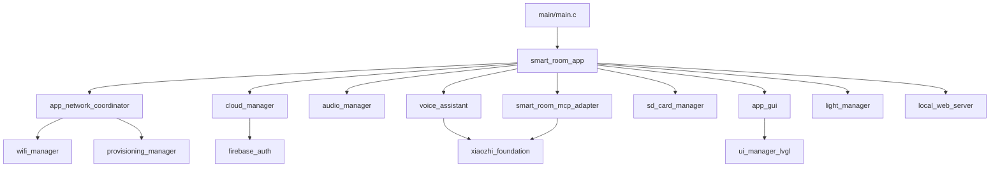
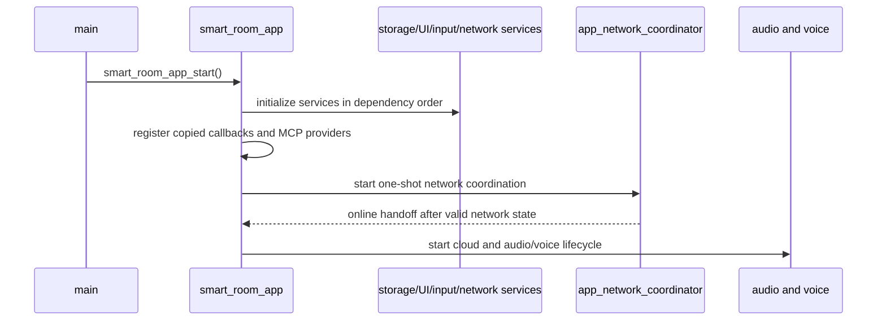

# Architecture

## Goal

The gateway is organized by runtime ownership. Each component owns its driver,
state, task, and cleanup rules; the product application composes components but
does not bypass their public boundaries.

## System Context



## Component Ownership

| Owner | Responsibility | Does not own |
|---|---|---|
| `smart_room_app` | Product startup order, policy values, and copied callback routing | Reusable driver internals |
| `app_network_coordinator` | Boot/provisioning/online handoff policy | Wi-Fi driver reconnect |
| `wifi_manager` | Station connection, DHCP state, reconnect policy | BLE provisioning or UI |
| `provisioning_manager` | Temporary BLE provisioning transport and verified credential handoff | Persistent configuration |
| `config_manager` | NVS schema, configuration, identity, clear/reset semantics | Wi-Fi connection |
| `audio_manager` | I2S RX/TX, DMA, PCM, recording, playback, WAV reader lifecycle | Voice/session policy or LVGL |
| `voice_assistant` | Conversation lifecycle, PTT owner/lease policy, audio arbitration requests | I2S/DMA ownership |
| `xiaozhi_foundation` | Managed Xiaozhi WebSocket/MCP engine, session, provider attachment | Product drivers or GUI |
| `smart_room_mcp_adapter` | Domain provider adaptation through public owner APIs | Managed MCP handles or hardware |
| `sd_card_manager` | SDSPI/FAT VFS lifecycle, recovery, and leases | WAV decode or LVGL rendering |
| `cloud_manager` / `firebase_auth` | Latest-value telemetry/retry and token lifecycle | GUI or sensor ownership |
| `local_web_server` | Bounded HTTP presentation and request translation | Browser audio capture or Wi-Fi lifecycle |
| `scene_manager` / `light_manager` | Scene decisions and logical light state/effects | Direct MCP engine ownership |
| `app_gui` / `ui_manager_lvgl` | Copied UI models, screens, LVGL task and synchronization | Arbitrary callback rendering |
| `log_manager` / `performance_monitor` | Persistent diagnostics and periodic resource observation | Application policy |
| `app_reset_coordinator` | Ordered factory-reset transaction | Button debounce or driver internals |

## Boot And Initialization Flow



The actual call order in `smart_room_app` is authoritative. Audio and voice are
deferred until the network coordinator reaches its required online/handoff
state; this is product policy, not transfer of I2S ownership.

## Data And Control Flow

- Sensor callbacks copy current state to the GUI model and latest cloud
  telemetry snapshot.
- Wi-Fi callbacks update network coordination, cloud network epoch, and copied
  UI state.
- Cloud work runs in the cloud owner task; UI callbacks do not perform HTTP or
  authentication work.
- Button events are copied to reset coordination; reset does not run in the
  debounce callback.
- Local Web handlers validate bounded requests and call public owners. They do
  not call LVGL or drive I2S directly.

## Xiaozhi Voice And MCP Flow

```text
GPIO38 or Local Web PTT
    -> voice_assistant owner/lease policy
    -> audio_manager capture arbitration
    -> xiaozhi_foundation managed WebSocket session
    -> response delivery gate / audio playback policy

Xiaozhi MCP tool
    -> xiaozhi_foundation schema and lifecycle boundary
    -> smart_room_mcp_adapter provider
    -> owning public manager API
    -> bounded copied result
```

`xiaozhi_foundation` retains managed provider/session handles. MCP callbacks do
not own storage handles, audio buffers, GPIO/RMT objects, Firebase credentials,
or LVGL. A controlled-action admission is not automatically completion of the
underlying asynchronous operation.

## Audio And Storage Boundaries

`audio_manager` is the only I2S/DMA owner. Its private WAV worker owns a
temporary `FILE *`, raw read buffer, and SD lease; the manager consumes only
bounded READY PCM blocks. `sd_card_manager` retains card mount/unmount and VFS
recovery ownership. This separation prevents a VFS remount beneath an active
stream and avoids a second I2S owner.

## Local Web Request Handling

The Local Web server starts only after application online handoff when enabled.
It exposes bounded endpoints for storage, audio, lights, dashboard, scenes,
logs, diagnostics, and remote PTT. HTTP callbacks translate requests to public
component APIs and return copied snapshots or accepted/busy/error outcomes.
Browser JavaScript does not capture microphone input or carry Xiaozhi audio.

## Task, Queue, And Callback Rules

- Callbacks are short and copy bounded state before returning.
- `app_gui`/`ui_manager_lvgl` own LVGL. No arbitrary producer callback may call
  LVGL directly.
- Component owner tasks perform long-lived network, audio, storage, and retry
  work. Public APIs use finite waits and documented admission results.
- Lifecycle teardown is cooperative. A resource-owning task is not force
  deleted while its resources may still be live.

## Memory Strategy

- Internal/DMA-capable memory holds ISR-visible I2S staging and time-sensitive
  data.
- PSRAM holds large non-DMA buffers such as retained audio and WAV prefetch
  storage.
- Internal and DMA heap figures overlap; they must not be summed as independent
  capacity.
- Provider, web, and GUI boundaries use bounded copied models rather than
  exposing driver handles or long-lived borrowed buffers.

## Failure And Recovery Boundaries

- Wi-Fi reconnect is owned by `wifi_manager`; provisioning is a temporary
  coordinator-controlled transport.
- Cloud retry and token refresh remain within cloud/auth owners.
- Audio cancellation and shutdown are cooperative; persistent SD failures end
  the active operation after the bounded recovery policy.
- Xiaozhi transport recovery uses its managed lifecycle and fails closed when a
  required response/transport fence cannot be established.
- Factory reset coordinates stop/clear/reboot policy without allowing unrelated
  components to persist or adopt configuration after reset wins.

## Design Rules

1. Keep hardware and persistent state in their owning component.
2. Prefer copied bounded snapshots across task and provider boundaries.
3. Treat a build, admission result, host test, and target evidence as distinct
   levels of validation.
4. Do not add a cross-component shortcut that bypasses lifecycle cleanup,
   thread ownership, or secret-handling boundaries.
