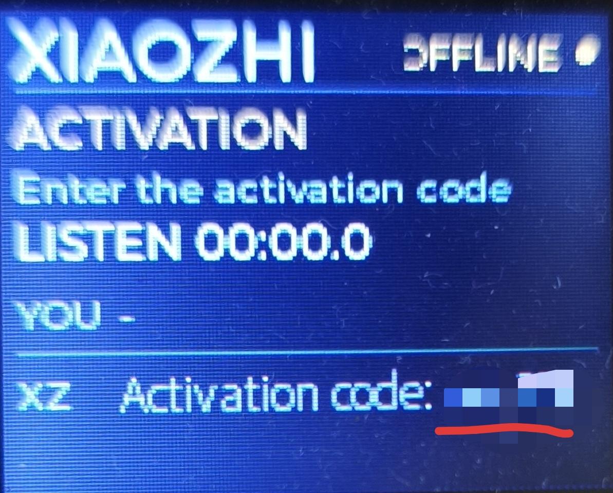
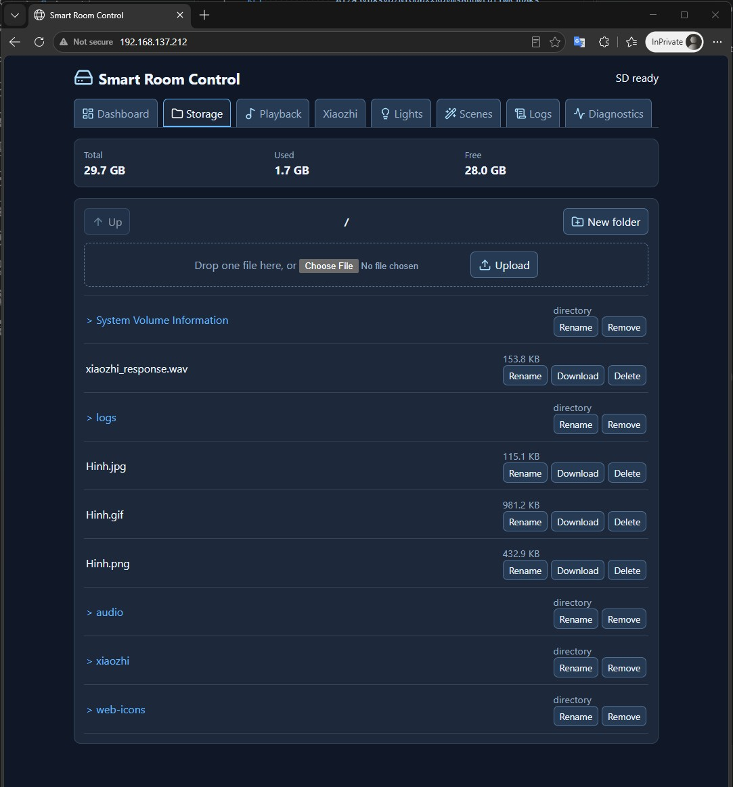
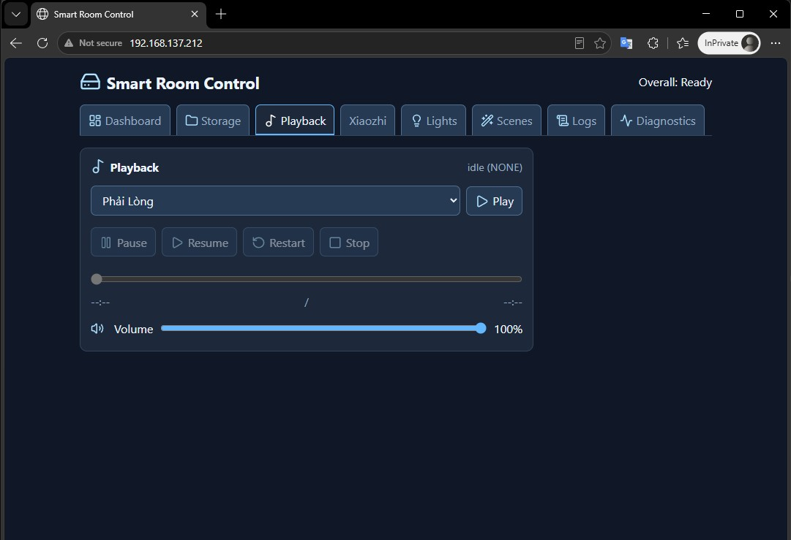
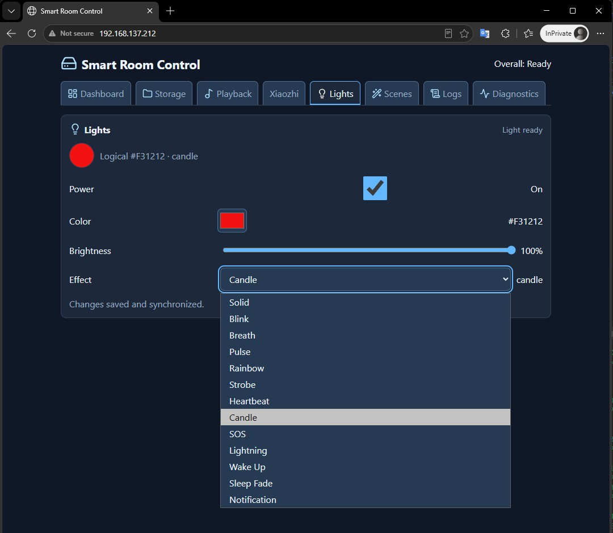
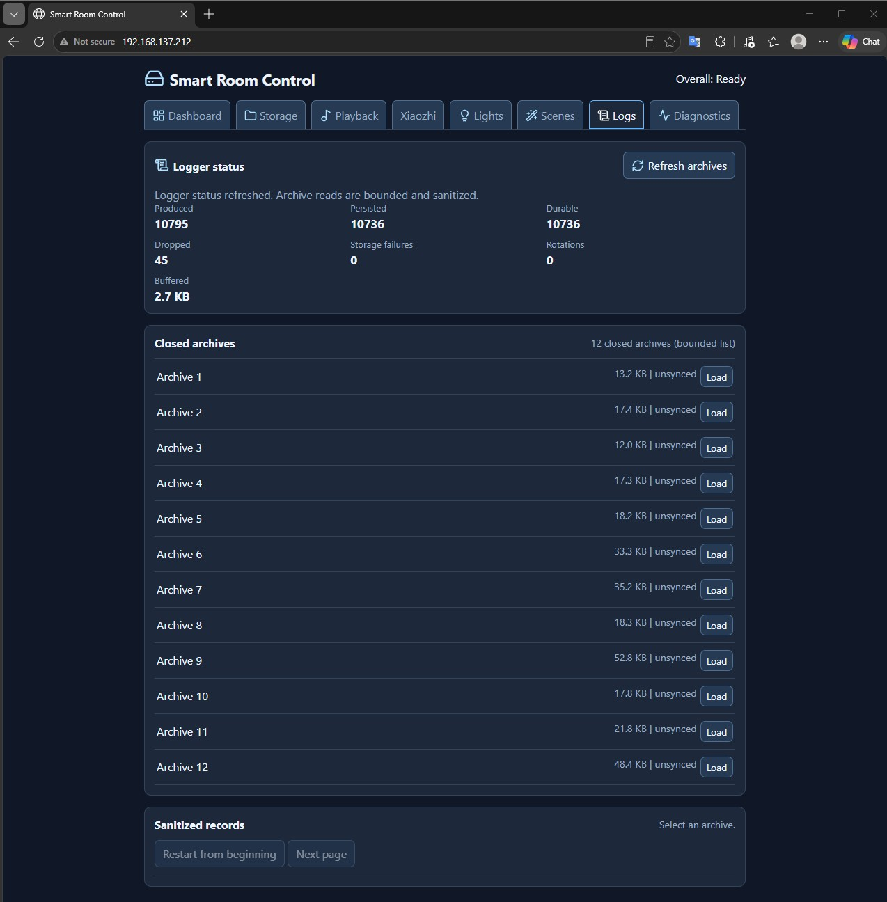
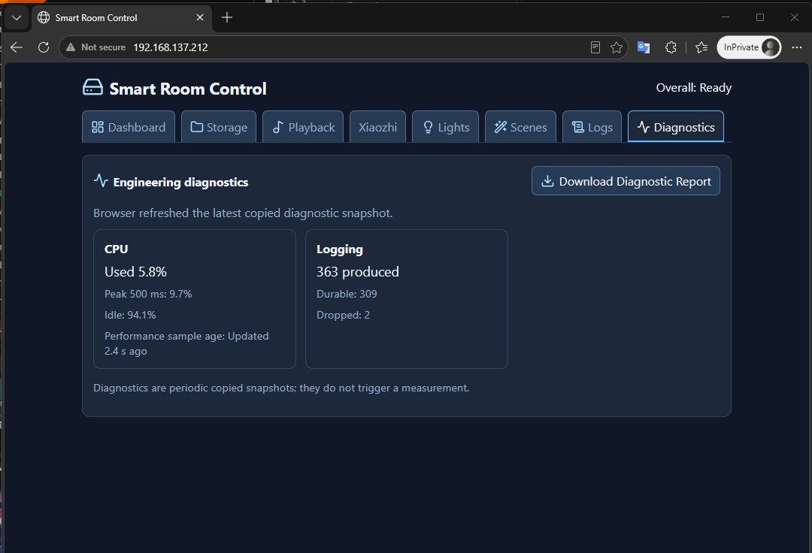
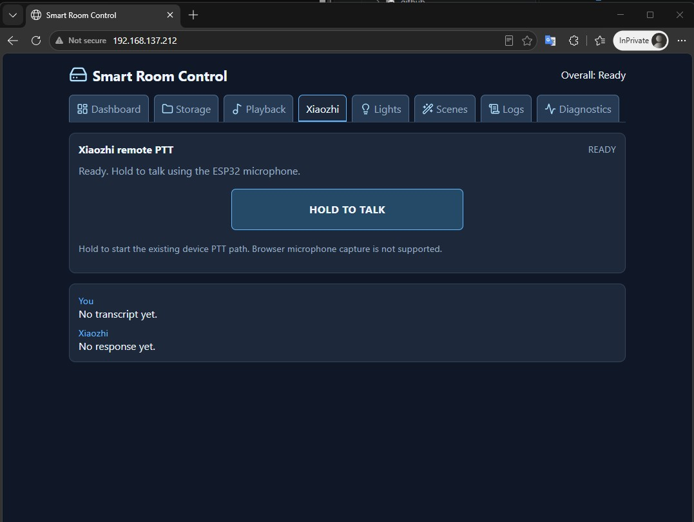
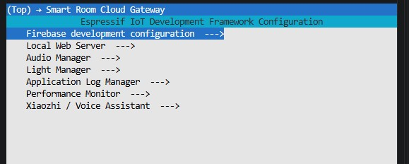
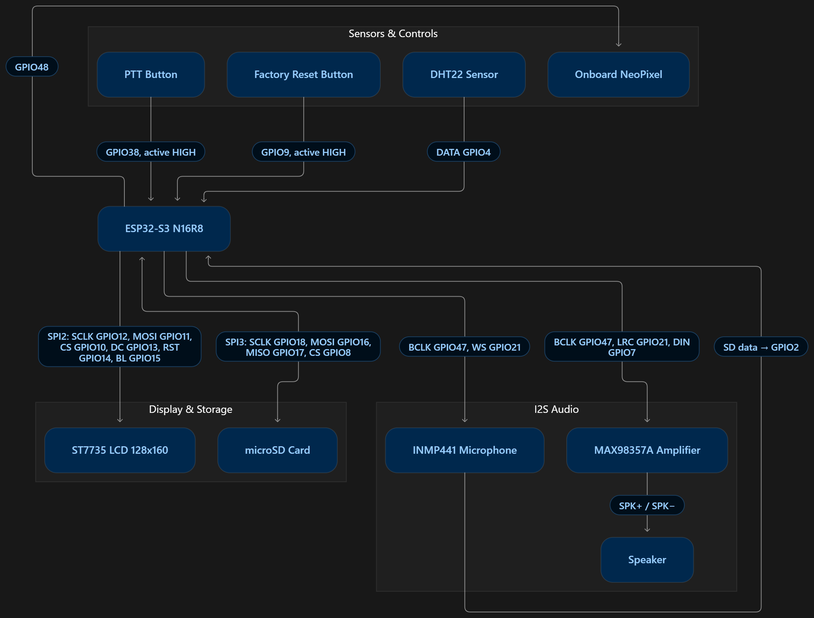

# Product Demonstration Guide

This guide preserves the published Version 1 evidence and defines a reproducible
Version 2 demonstration. Available V2 media and any still-missing optional
captures are recorded in [the media manifest](media/V2_MEDIA_ASSETS.md).

## Existing Version 1 Evidence

[Version 1 hardware demo](https://youtube.com/shorts/9C5_hecEgXA?feature=share)
and the images under `docs/media/` demonstrate the baseline LCD, provisioning,
sensor/cloud, and factory-reset gateway flows. They do not claim V2 audio,
Xiaozhi, MCP, or Local Web acceptance.

## V2 Demonstration Preconditions

- Build the documented V2 source on ESP-IDF 6.0.1.
- Wire the documented target hardware and use a trusted Wi-Fi network.
- Prepare a sanitized FAT SD card with an accepted WAV track when demonstrating
  storage or playback.
- Configure Firebase locally without exposing credentials.
- Complete Xiaozhi account/agent setup and activation when required.
- Enable Local Web only when the intended same-network browser is available.

## Demonstration Sequence

| Step | User action | Expected observable behavior | Verification and media |
|---:|---|---|---|
| 1 | Show the powered prototype. | LCD, SD, audio hardware, controls, and wiring are visible. | `v2-hardware-overview.jpg` |
| 2 | Boot the device. | Boot/UI status progresses without exposing secrets. | `v2-lcd-dashboard.jpg` |
| 3 | Show Wi-Fi/sensor dashboard. | Copied network and DHT22 state render on LVGL. | Existing V1 evidence or V2 dashboard capture. |
| 4 | Open Local Web after online handoff. | Dashboard/control surface loads from the device network. | `v2-local-web-overview.jpg` |
| 5 | Browse/upload/download safe SD content. | Bounded storage operation reports an honest result. | `v2-local-web-storage.jpg` |
| 6 | Select an accepted WAV track and play/control it. | UI shows scheduling/state; only audio observation proves sound. | `v2-local-web-playback.jpg` |
| 7 | Change light state or apply a scene. | Light/scene result is visible; busy/partial results are not hidden. | `v2-local-web-lights.jpg`; scene capture not provided. |
| 8 | Show Xiaozhi activation if the backend requires it. | Bounded code/message is shown; sensitive code is redacted for public media. | `v2-xiaozhi-activation.jpg` |
| 9 | Hold GPIO38 PTT and speak a harmless test phrase. | Voice state transitions and later semantic/audible result are observable. | [V2 PTT demonstration](https://youtube.com/shorts/rdfI0ZxzbNA?feature=share) |
| 10 | Ask an MCP sensor question. | The response reflects copied sensor state, not fabricated data. | `v2-mcp-sensor-query.jpg` — PENDING OWNER UPLOAD |
| 11 | Request an MCP light/audio/cloud action. | Show the owning state/result; cloud/audio admission is not completion. | `v2-mcp-light-control.jpg` or `v2-mcp-audio-playback.jpg` — PENDING OWNER UPLOAD |
| 12 | Open logs/diagnostics. | Sanitized diagnostic view renders without secrets or private paths. | `v2-local-web-logs.jpg` and `v2-local-web-diagnostic.jpg` |

## Published V2 Evidence

| Hardware | LCD dashboard | Xiaozhi activation |
|---|---|---|
|  |  |  |

| Local Web overview | Storage | Playback |
|---|---|---|
|  |  |  |

| Lights | Logs | Diagnostics |
|---|---|---|
|  |  |  |

| Local Web Xiaozhi | Menuconfig | Hardware schematic |
|---|---|---|
|  |  |  |

Watch the [PTT demonstration](https://youtube.com/shorts/rdfI0ZxzbNA?feature=share)
and [full V2 demonstration](https://youtu.be/r4Q5xO2WkmA). The editable
[Mermaid schematic source](media/v2/v2_Schematic.mmd) is stored with the image.

## What To Record

Use the fixed paths in the media manifest. The minimum convincing V2 set is the
hardware overview, LCD dashboard, activation state where applicable, PTT video,
Local Web overview, and full end-to-end demo video. Recommended captures add
MCP, playback, storage, light, scene, and diagnostics evidence.

## Evidence Interpretation

- A successful build verifies compilation, not hardware behavior.
- An accepted MCP/Web request may be queued or rejected later by its owner; do
  not label it as completed cloud upload or audible playback without evidence.
- A V1 image/video remains V1 evidence unless it visibly demonstrates a V2
  capability on the stated release source.
- Redact private data before upload and retain the release commit used for a
  capture when reproducibility matters.

## Deferred Evidence

Wake word and advanced always-on voice UX are outside V2.0.0. Do not present
future/experimental wake-word behavior as part of this demonstration.
